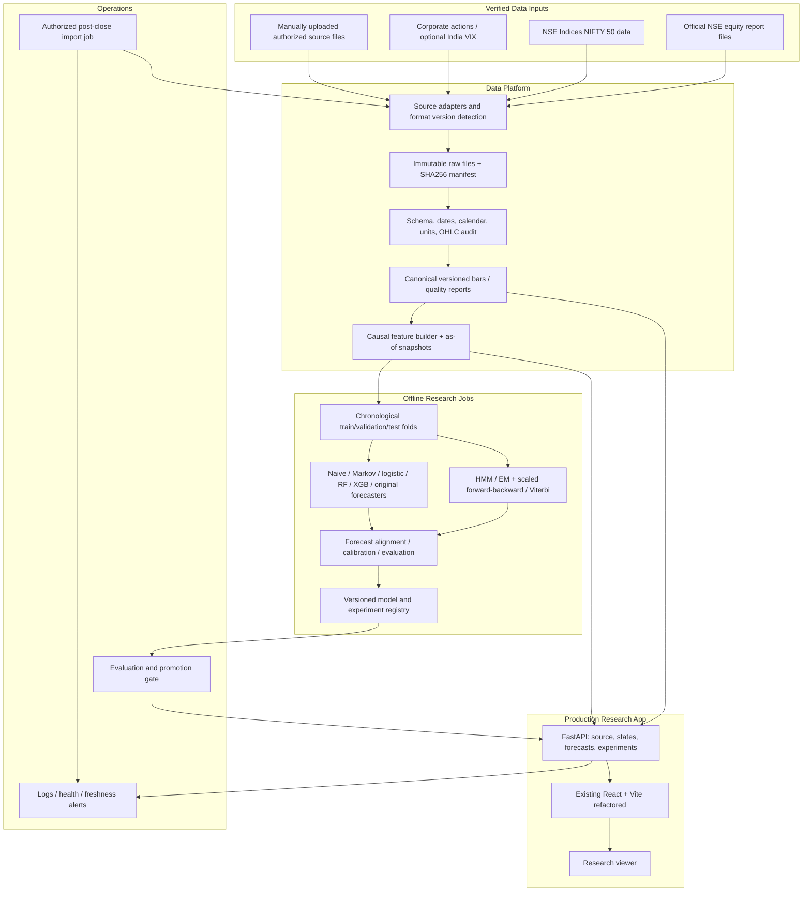

# BullBench MarkovLab — Extended Architecture and Migration Blueprint

**Status:** Proposed architecture, based on an inspection of the existing public BullBench source tree on 4 November 2026. This is **not** a claim that the new modules, models, endpoints, or latest dataset are implemented.

**Parent project:** `NipunThakuria02/BullBench`  
**New repository:** `BullBench-MarkovLab` (separate Unit 4 deliverable)  
**Related specifications:** [`../PRD.md`](../PRD.md), [`../WORKFLOW.md`](../WORKFLOW.md), [`../RULES.md`](../RULES.md), [`ARCHITECTURE.md`](ARCHITECTURE.md), [`ML_EXPERIMENTS.md`](ML_EXPERIMENTS.md), [`API_SPEC.md`](API_SPEC.md), [`DATA_SOURCES.md`](DATA_SOURCES.md), [`TEST_PLAN.md`](TEST_PLAN.md)

## 1. Architectural intent

Extend, rather than rewrite, BullBench's original research pipeline. Preserve the proven ability to compare next-session return forecasts across multiple NSE instruments while adding a **separate primary Unit 4 experiment**: forecasting the probability that the next completed NSE session has an unusually large absolute return using Hidden Markov Models (HMMs) versus appropriate baselines. The old closing-price benchmark is a *secondary* experiment.

The deployed site is a **research application**, not a trading system, real-time execution platform, or an investment recommendation engine. Latest available data means **latest source-verified completed NSE session**, not a claim of real-time exchange streaming.

### Primary boundaries

1. **Ingestion** fetches/imports actual permitted NSE/NSE Indices files and records provenance.
2. **Normalization** creates immutable, validated, consistent daily price series.
3. **Research** implements causal features, HMM inference, competitor training, time-based validation and final test evaluation.
4. **Registry** stores the selected model *and every preprocessing dependency*, metrics and version information.
5. **Inference API** serves predictions with saved artifacts, not retraining in web requests.
6. **Web app** visualizes the data, observed/inferred regimes, transitions, comparisons, prediction freshness, and limitations.
7. **Refresh job** imports newly available daily reports and recomputes causal predictions; training is a separate gated action.

## 2. Actual BullBench starting point (verified source-tree snapshot)

Existing repository files observed:

```text
BullBench/
├── pyproject.toml
├── requirements.lock
├── vercel.json
├── vite.config.ts
├── src/nse_forecast/
│   ├── __init__.py
│   ├── cli.py              # download, evaluate, export-site, audit, report operations
│   ├── config.py           # tickers, sectors, fixed historical date bounds
│   ├── data.py             # yfinance download, cache and Close-value validation
│   ├── features.py         # lagged returns, rolling vol and time-aligned context
│   ├── models.py           # Naive, Ridge, Random Forest, XGBoost, ARIMA
│   ├── evaluate.py         # expanding-train, quarterly test walk-forward
│   ├── diagnostics.py      # research diagnostics
│   ├── audit.py            # data quality/audit
│   ├── provenance.py       # cache/source provenance checks
│   ├── import_csv.py       # external sector-index CSV importer
│   ├── history.py          # history outputs
│   ├── report.py           # research report generation
│   └── web.py              # lightweight Python HTTP/JSON export serving
├── web/
│   ├── package.json       # Vite, React, TypeScript, Playwright
│   ├── src/
│   │   ├── main.tsx
│   │   ├── assets.ts
│   │   ├── data.ts
│   │   ├── history.ts
│   │   ├── charts.tsx
│   │   ├── equations.tsx
│   │   └── styles.css
│   └── tests/
├── tests/
│   ├── test_history.py
│   ├── test_import_csv.py
│   ├── test_pipeline.py
│   ├── test_price_accuracy.py
│   ├── test_research_revision.py
│   └── test_web.py
├── scripts/setup.sh
└── docs/
```

**Observed source behavior:** `data.py` currently relies on `yfinance` and a strict fixed end date; `features.py` contains conservative context-release timing assumptions; `models.py` compares five return predictors; `evaluate.py` performs expanding quarterly evaluation; `web.py` can serve existing reports and exports; React's `data.ts` knows only the original five models and static response shapes. These are migration hotspots. This is a source-structure inventory, **not** a runtime audit of the original deployed website.

## 3. Target system architecture



### Training flow vs serving flow

- **Offline:** Import a frozen data snapshot → audit → create causal features → define horizon and train-only threshold → chronological folds → train/validate HMM and baselines → select by validation → one untouched test evaluation → publish a fully versioned *bundle*.
- **Online/on-demand:** Request asset + as-of session → verify latest approved data → reconstruct only available lagged features → load matching saved bundle → update HMM filtering through as-of observations → compute next-session large-move probability (and secondary closing-price forecast if supported) → return a traceable response.
- **Daily refresh:** Authorized pull/import of published end-of-day files → verify checksums/date/semantics → atomic data commit → infer using the currently deployed model → refresh cache. **No automatic model refit merely because a new file arrived.**

## 4. Target repository tree (incremental migration)

`KEEP` means preserve/refactor rather than delete. `NEW` means proposed functionality.

```text
BullBench-MarkovLab/
├── README.md                       # UPDATE: overview, run instructions, limitations
├── PRD.md                          # EXISTING documentation
├── RULES.md                        # EXISTING documentation
├── WORKFLOW.md                     # EXISTING documentation
├── pyproject.toml                  # KEEP/UPDATE: FastAPI, hmmlearn, etc.; pinned lock
├── .env.example                    # NEW: only nonsecret placeholders
├── .gitignore                      # KEEP/UPDATE: raw licensed data / artifacts / secrets
├── config/
│   ├── assets.yaml                 # NEW: symbol, type, active date range, source policy
│   ├── experiment.yaml             # NEW: targets, horizons, splits, threshold protocol
│   └── sources.yaml                # NEW: allowed providers and format versions
├── src/nse_forecast/               # KEEP namespace initially to reduce migration risk
│   ├── cli.py                      # EXTEND with ingest-official, research, serve commands
│   ├── config.py                   # REFAC: remove fixed END assumptions
│   ├── data.py                     # REFAC: delegate import to source adapters
│   ├── features.py                 # EXTEND causal observation and target builders
│   ├── models.py                   # KEEP existing price forecasters intact initially
│   ├── evaluate.py                 # KEEP legacy evaluation; new unit4 evaluation separate
│   ├── diagnostics.py              # EXTEND with HMM state diagnostics
│   ├── provenance.py               # EXTEND manifest/source/version metadata
│   ├── audit.py                    # EXTEND source and adjusted-price audits
│   ├── import_csv.py               # KEEP sector index import; audit its compatibility
│   ├── history.py                  # KEEP; expose future API-compatible results
│   ├── report.py                   # KEEP; add new research report later
│   ├── web.py                      # KEEP temporarily for regression checks; retire as primary API
│   ├── ingest/                     # NEW
│   │   ├── nse_udiff.py            # current UDiFF equity report adapter
│   │   ├── nifty_index.py         # index-history adapter
│   │   ├── corporate_actions.py    # adjusted/unadjusted price policy
│   │   ├── calendar.py            # sessions, holidays, special trading days
│   │   └── manifest.py            # hashes, source URL, release/as-of times
│   ├── validation/                 # NEW
│   │   ├── ohlcv.py
│   │   ├── source_reconciliation.py
│   │   └── quality_report.py
│   ├── unit4/                      # NEW: actual Unit 4 implementation
│   │   ├── observations.py         # emission features, time alignment
│   │   ├── targets.py              # train-only large-move threshold
│   │   ├── hmm_model.py            # fitted Gaussian HMM, seeds, constraints
│   │   ├── forward_backward.py     # stable forward/backward filtering & smoothing
│   │   ├── viterbi.py              # retrospective best-state decoding
│   │   ├── forecasting.py         # causal transition + predictive probabilities
│   │   ├── markov_baseline.py      # observed-state Markov reference
│   │   └── state_labels.py         # post-hoc descriptive interpretation only
│   ├── experiments/                # NEW
│   │   ├── splits.py               # purged/embargoed folds when warranted
│   │   ├── classification.py       # logistic/RF/XGB and persistence baselines
│   │   ├── legacy_price.py         # adapters to original close/return experiment
│   │   ├── regime_aware.py         # HMM causal features + price predictor
│   │   ├── scoring.py              # PR-AUC, Brier, log loss, MAE/RMSE
│   │   ├── walkforward.py
│   │   └── leaderboard.py
│   └── artifacts/                  # NEW
│       ├── bundle.py               # scaler + HMM + classifiers + thresholds
│       ├── registry.py             # experiment run IDs, immutable manifests
│       └── compatibility.py        # feature schema and version checks
├── backend/                         # NEW FastAPI app, imports Python package
│   └── app/
│       ├── main.py
│       ├── settings.py
│       ├── schemas.py
│       ├── api/{health,assets,data,states,predictions,experiments}.py
│       ├── services/{data_service,inference_service,registry_service}.py
│       └── security/{upload_validation,rate_limit}.py
├── web/                              # KEEP existing Vite/React project
│   └── src/
│       ├── main.tsx                 # REFAC: app layout / routing
│       ├── assets.ts                # KEEP: symbol registry
│       ├── data.ts                  # REFAC: typed API client and old data adapter
│       ├── charts.tsx               # KEEP/EXTEND: probability/state plots
│       ├── history.ts               # KEEP/EXTEND: latest vs historical source
│       ├── equations.tsx            # KEEP: Unit 4 derivation panels
│       ├── styles.css               # KEEP aesthetic, responsive styles
│       ├── api/{client,contracts}.ts # NEW
│       └── features/                # NEW
│           ├── overview/
│           ├── states/
│           ├── transitions/
│           ├── experiments/
│           ├── predictions/
│           └── provenance/
├── scripts/
│   ├── ingest_official.py           # NEW
│   ├── audit_snapshot.py            # NEW
│   ├── train_unit4.py               # NEW
│   ├── evaluate_unit4.py            # NEW
│   ├── promote_model.py             # NEW
│   ├── refresh_after_close.py       # NEW, optional permitted automation
│   └── reproduce_release.py         # NEW
├── tests/
│   ├── ...original tests...         # KEEP, run throughout migration
│   ├── test_nse_adapters.py         # NEW
│   ├── test_asof_availability.py    # NEW
│   ├── test_hmm_forward_backward.py # NEW
│   ├── test_hmm_viterbi.py          # NEW
│   ├── test_hmm_no_lookahead.py     # NEW
│   ├── test_threshold_leakage.py    # NEW
│   ├── test_split_integrity.py      # NEW
│   ├── test_inference_contract.py   # NEW
│   └── test_artifact_reload.py      # NEW
├── data/                             # local / protected, not public data dump
│   ├── raw/ normalized/ snapshots/ manifests/ quality/
├── model_registry/                   # protected, immutable release artifacts
├── reports/                          # aggregate experiments and model cards
└── docs/
    ├── ARCHITECTURE.md
    ├── ARCHITECTURE_EXTENDED.md       # THIS FILE
    ├── DATA_SOURCES.md
    ├── ML_EXPERIMENTS.md
    ├── API_SPEC.md
    ├── TEST_PLAN.md
    └── BUILD_CHECKLIST.md
```

**Note on package names:** Preserve `src/nse_forecast` and the existing `nse-forecast` CLI entry point during the first migration stages. Renaming imports, CLI, or the package should be a standalone later change with a passing test suite, not combined with new ML features.

## 5. Existing-file change map

| Existing module | Keep | Modify / extend | Reason / acceptance test |
|---|---|---|---|
| `src/nse_forecast/config.py` | Symbols / mappings | Replace hard-coded end date with per-source verified as-of date and flexible coverage | New official files work without hard-code patching |
| `data.py` | Existing validation and cache logic | Add official adapters and canonical schema, preserve `yfinance` only as separately labelled legacy path if retained | No silent source switch; hash/manifest per import |
| `features.py` | Existing lagged returns/context logic | Add HMM observations, release-aware context, target derivation and forecast cutoffs | No future observation appears in forecast features |
| `models.py` | All five original baseline implementations | Isolate/adapter for secondary price experiment | Original research results remain reproducible |
| `evaluate.py` | Quarterly walk-forward logic and existing metrics | Add isolated Unit 4 evaluation service; do not conflate target types | Separate reports for risk vs price metrics |
| `diagnostics.py` | Existing model diagnostics | Add HMM state uncertainty, dwell time and transition checks | Numeric summaries with model version |
| `provenance.py`, `audit.py` | Current provenance checks | Add official source and corporate-action reconciliation | Dataset manifest and row-level exclusion log |
| `web.py` | Old report endpoint for migration | Replace primary serving with FastAPI; optionally retain legacy read-only exporter | No frontend dependency on local report files in production |
| `web/src/data.ts` | Existing data type conventions | Add distinct `LargeMoveForecast`, `StateHistory`, `ExperimentResult` schemas | Runtime type guards prevent mismatched payloads |
| `web/src/main.tsx` | Navigation/visual language | Modular pages for HMM regimes, transitions, predictions and methods | Source freshness and as-of date visible in every forecast |
| `web/src/charts.tsx` | Existing chart components | Add confidence bands, probability scales and state timeline | No fabricated performance or forecast values |
| `tests/` | Original tests | Add HMM, date, source and API regression tests | Existing + new suites pass before promotion |

## 6. Domain contracts and canonical data schema

**Bar record**: `instrument_id`, `session_date`, `open`, `high`, `low`, `close`, `volume` (nullable where not applicable), `exchange`, `segment`, `series`, `price_basis` (`raw_close` or correctly adjusted), `source_id`, `asof_published_at`, `downloaded_at`, `data_version`, `quality_status`.

**Context feature**: `name`, `value`, `observation_session`, `source_published_at`, `available_at`, `asof_cutoff`, `source_id`; disallow context values with `available_at > asof_cutoff`.

**Forecast record**: `forecast_id`, `asset`, `origin_session`, `origin_cutoff`, `target_session`, `target_definition`, `predicted_probability_or_return`, `model_id`, `data_version`, `feature_schema_version`, `trained_through`, `generated_at`, `freshness`, `warnings`.

**Experiment record**: code commit, data manifest hash, feature schema hash, target definition, threshold learned on training subset, fold boundaries, seed, library versions, hyperparameters, predictions, metrics, source/quality warnings, selected model, final test result.

**Price basis rule:** Do not mix the original yfinance `auto_adjust=True` closes with unadjusted official NSE close. Either document and implement corporate-action adjustments or explicitly retrain/evaluate using verified raw closes and disclose differences from the old BullBench results.

**Calendar rule:** Do not fill holidays/weekends as price bars. Indian special trading sessions, suspensions, and source-publication delays require explicit calendar validation.

## 7. Unit 4 modeling architecture

### 7.1 Two related but separate tasks

**Primary (classification/probability):** For asset `a`, at completed session `t`, forecast the probability that the *next trading session's* absolute log return exceeds a threshold `q_a` estimated **using training data only**. Threshold and target horizon must be fixed and logged. No target values may be incorporated as input features.

**Secondary (regression):** Predict next-session return/close; report return and price errors as the original BullBench did. Add an HMM-derived causal feature ablation (`no-regime` vs `regime-aware`) with identical splits and information sets.

### 7.2 HMM mathematical interface

- Observations: transformed past/current log returns, lagged realized vol, optional time-available VIX and market return; decisions about current-close availability must be explicit.
- Fit: Gaussian HMM on training sequences, EM (Baum-Welch), robust scaling fit in training only. Select state count and covariance specification on validation folds only.
- Forward filter: `alpha_t = normalize((alpha_(t-1) @ A) * emission(x_t))` in a log-scaled or stable implementation.
- Prediction: `p(z_(t+1) | x_<=t) = alpha_t @ A`. Derive large-move probability using training-estimated, calibrated conditional outcome probabilities or an explicitly specified predictive emission distribution; **do not directly equate a hidden-state ID with a large-move label**.
- Backward/smoothing: retrospective diagnostics only. Never input smoothed `p(z_t | x_1:T)` into a historical forecast where `T > t`.
- Viterbi: retrospective most-likely path; not the live forecast.
- Scaling factors: provide demonstrable underflow-safe forward likelihood, posterior normalization and tests against small hand-checkable examples.

### 7.3 Comparators and fair scoring

- Primary comparators: historical class-rate baseline, persistence rule, simple observed-state Markov baseline, logistic regression, RF and XGBoost.
- Model outputs: calibrated probabilities for **the identical next-session event**. Fit calibration using training/validation only.
- Score: Brier/log loss, PR-AUC, balanced accuracy and macro-F1 at a validation-chosen threshold; calibration and minority-class counts always shown.
- Secondary comparison: Naive, Ridge, ARIMA, RF, XGB, HMM-based return forecast, and HMM-feature-augmented variant; score MAE/RMSE and baseline skill.
- No universal “best model” from a weighted mix of unrelated metrics; state the selection criterion per task before training.

## 8. API and frontend architecture

Use the detailed contract in `API_SPEC.md`. Endpoint groups: `/health`, `/v1/assets`, `/v1/data/status`, `/v1/assets/{asset}/history`, `/v1/assets/{asset}/states?view=...`, `/v1/assets/{asset}/transitions`, `/v1/predict/large-move`, `/v1/predict/next-close`, `/v1/experiments`, and permissioned data validation.

**Frontend screens (retain BullBench look and feel):**
1. **Overview:** assets, data as-of, official provenance, latest completed close.
2. **Hidden States:** filtered and Viterbi timelines, historical smoothed-only toggle explicitly marked retrospective.
3. **Transition Lab:** transition matrix, expected dwell times with uncertainty context, forward-filter explanation.
4. **Risk Forecast:** next-session risk probability with threshold, baseline, as-of, and freshness.
5. **Original BullBench comparison:** secondary next-close forecasts and original five baselines plus HMM ablation.
6. **Model Research Lab:** folds, reproducible metrics, calibration, regime stability and model cards.
7. **Data Quality:** missing sessions, corporate-action flags, source hashes, latest import, data limitations.

**Frontend data policy:** Never use the old `exampleRows` or hardcoded outputs in production prediction views. Show a clearly marked unavailable/error state instead of generated placeholder predictions. Cache only metadata and licensed-permitted aggregates. If API is unavailable, show stale status, not success.

## 9. Storage and operations

- **Raw/source files:** Protected immutable archive with sha256 and original filename/source metadata.
- **Normalized records:** Parquet for reproducible research; PostgreSQL optional for production queries.
- **Registry:** Per-version fitted scaler, HMM, classifiers, target threshold, feature columns, training dates and manifest; atomic pointer to approved model.
- **Refresh:** Trigger once after the actual report is released, not on wall-clock assumption alone; compare publication date and last verified trading session.
- **Monitoring:** Health check, latest source date, latest successful import, missing session counts, inference latency, model version and validation failure rate.
- **Security:** Secrets in server env only; uploads authenticated or strictly constrained; never execute uploaded code or trust filenames; rate-limit inference; never expose restricted NSE raw redistributions.
- **Deployment:** Vite app on static host, FastAPI on Python container service, persistent backing storage for data+artifacts. Container deployment must load a pre-approved model bundle and pass health readiness checks.

## 10. Migration stages and exit gates

| Gate | Implementation work | Exit criteria |
|---|---|---|
| M0 — Baseline freeze | Copy repo, lock dependencies, run original tests and produce a reference evaluation | Original CLI, site build and tests pass on original permitted data |
| M1 — Data source modernization | Official adapters, UDiFF support, calendar/source reconciliation, raw/adjusted policy | Source-verified latest history, no unexplained gaps or lookahead |
| M2 — HMM research core | Gaussian HMM, EM, forward/backward/scaling, Viterbi, transition forecasts | Numerical checks, chronological training and causal-state tests pass |
| M3 — Comparative experiments | Risk target, all baselines, validation selection, untouched test, closing-price ablation | Reproducible metrics for both separate tasks; no leakage |
| M4 — API + frontend | FastAPI endpoints, React modular views, freshness and honest error states | End-to-end API inference from new permissible observations works |
| M5 — Operations/release | Import schedule/manual fallback, model registry, deployment, automated tests | Consistent artifact reload, health/readiness, documented methodology and demo |

## 11. Developer build order / first files to touch

1. Branch/copy original and preserve a baseline test run (`pyproject.toml`, `tests/`, `web/`).
2. Update `config.py`/`data.py` to remove hard-coded historical end constraints while retaining old behavior under an explicit legacy profile.
3. Add source-specific official adapters + schema validation + source manifest; audit at least one stock and NIFTY 50 before collecting all symbols.
4. Freeze a verified data snapshot and implement forecast cutoff/feature availability tests.
5. Create `unit4/targets.py`, `unit4/observations.py`, `unit4/hmm_model.py`, `unit4/forward_backward.py`, `unit4/viterbi.py`, `unit4/forecasting.py`.
6. Add `experiments/` separate from existing `evaluate.py`; establish independent primary classification results.
7. Build save/reload bundle with exact features, thresholds and fitted preprocessing.
8. Add FastAPI and typed frontend API contracts; migrate dashboard one view at a time.
9. Add latest-data refresh, nightly audit (only where access permits), version reporting and failure handling.
10. Produce release model card with confirmed data through-date, exact model comparisons and limitations.

## 12. Explicit non-goals and blocked assumptions

- No fabricated or simulated market records for training/test; tiny deterministic fixtures **only for checking algorithm mathematics**.
- No guarantee of HMM outperforming any baseline.
- No intraday real-time or live-trading claim based on daily close data.
- No claim that raw latent states are independently verified “bull/bear” labels.
- No reconstruction of unavailable adjusted prices by naive scaling.
- No reliance on third-party scraping in violation of providers' terms; if official automated access is unavailable, use authorized manual official exports and label update mode accurately.
- No assertion that the latest market series has been downloaded until manifests prove it.

## 13. Acceptance checklist

- [ ] Six core assets reproducibly ingest with verified source provenance.
- [ ] Forecast as-of cutoff, corporate-action policy and session calendar are documented.
- [ ] HMM forward, backward, scaling, Viterbi and training are genuinely implemented and tested.
- [ ] Prediction probabilities are causal and calibrated/validated where suitable.
- [ ] Common target and split definitions allow HMM vs non-HMM fair comparisons.
- [ ] Untouched test metrics and forecast ledger can be reproduced from released artifacts.
- [ ] Frontend calls FastAPI for predictions; no silent static fallback.
- [ ] Model registry includes threshold, scaler, schema, data and code versions.
- [ ] Newly imported source observations update inference but do not implicitly refit.
- [ ] Production copy clearly states **research only**, data as-of, and uncertainty/limits.

---

**Implementation principle:** Make the smallest reliable change at each gate. Research correctness, data provenance and causal inference are more important than adding more algorithms or animated UI effects.
