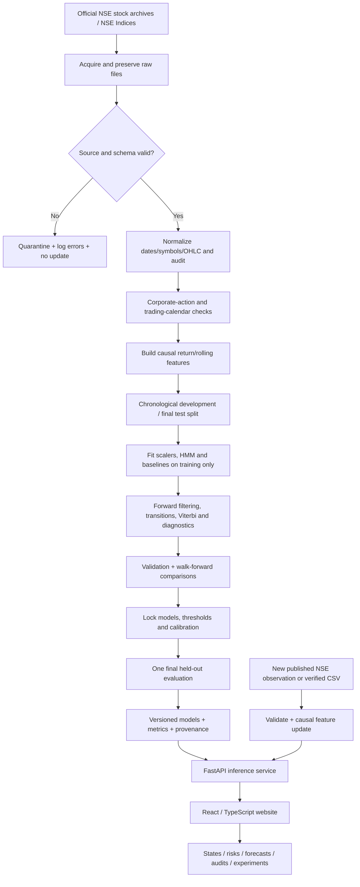
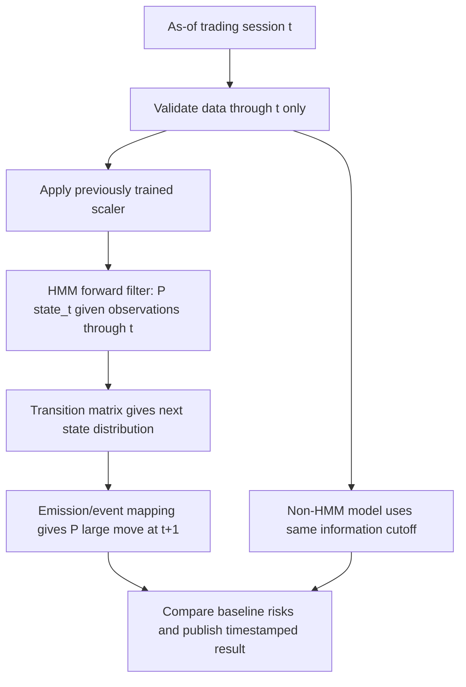

# WORKFLOW — BullBench MarkovLab

## Main system flowchart

## Time-safe prediction flow

Viterbi paths and forward-backward smoothed states are for retrospective display and **must not enter historical real-time forecasts**.

## Milestone-by-milestone execution
### 0. Bootstrap
- Fork/copy original BullBench into **new repository**, preserve attribution; freeze baseline branch and note commit hash.
- Create Python environment and frontend dependency lockfiles. Confirm code can run before edits.
- Record original pipeline/test behavior and original datasets as references, not new results.

### 1. Collect official history
- Determine authorized download path for CM-UDiFF common bhavcopy (post-2024) and earlier price-volume archives.
- Pull the target six assets and NIFTY 50 from NSE Indices; optional VIX and corporate actions.
- Preserve untouched files; inventory date range, file checksums, data rights, retrieved timestamps and symbols.
- Fail G0 if continuity, target metric, terms or adjustment policy cannot be resolved.

### 2. Standardize and audit
- Parse by source-specific, versioned adapters. Validate OHLC, volume, date, supported symbols/series.
- Reconcile trading days, duplicates, missing sessions and corporate actions. Output `data_quality_report.json` and rejected rows.
- Define and lock unadjusted-vs-adjusted price policy before modelling.

### 3. Design target and split
- Freeze next-session large-absolute-log-return threshold policy (training-only quantile or fixed prespecified threshold).
- Freeze per-asset date blocks and late-period untouched final test range, excluding incomplete sessions.
- Determine availability of volume/VIX features at the end-of-day as-of cutoff; avoid unavailable historical features.

### 4. Unit 4 algorithms
- Add Gaussian HMM (with stable log/scaled forward calculations, backward and Viterbi); compare 2/3/4 states via validation.
- Record random seed, convergence warnings, initializations, EM log likelihood and state statistics.
- Unit tests with known deterministic reference probabilities; no generated market training data.

### 5. Comparable experiments
- Primary: HMM risk versus prevalence, persistence/observable Markov, Logistic Regression, RF and XGBoost.
- Secondary: original price baseline+models versus HMM expected return / HMM-filtered-feature ablation.
- Only fit models/preprocessing within each training fold. Repeat expanding folds on development period.
- Lock winner using validation only; run final held-out test once, publish all test results even if poor.

### 6. API and website
- Build FastAPI with versioned model loader. Implement status, history, state path/probability, transitions, model metrics and inference routes.
- Adapt existing React UI, display raw source timestamp and as-of date, label historical smoothed vs filtered states.
- Permit verified CSV upload for new observations; no silent database mutation, model retraining or fabricated freshness.

### 7. Operations and release
- Add idempotent periodic/explicit official-report ingestion, missing-day reports, logs and stale-data banner.
- Security and performance tests; produce video/demo steps and deployment guide.
- Publish methods, reproducibility notes, limitations, acknowledgements and Unit 4 viva explanations.

## Developer working agreement
Complete a gate, run its tests, commit the artifacts and the recorded decisions before starting next. Every changed model claim must link to actual saved predictions and experiment configuration. Never hard-code performance numbers into frontend components.
